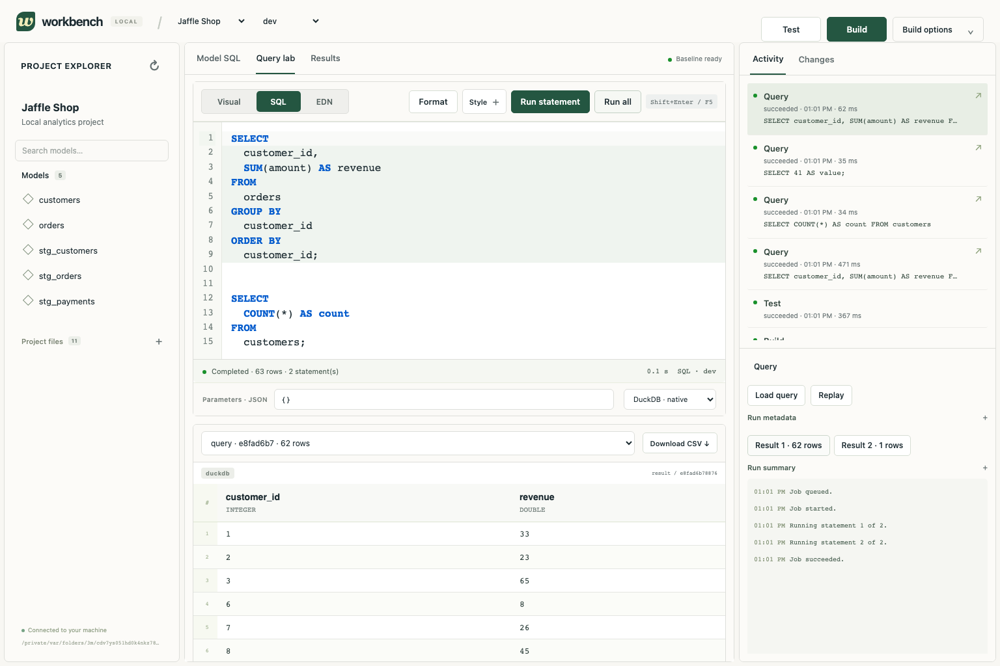

# dbt Workbench

A local dbt editor and query lab built with Clojure, ClojureScript, HoneySQL, and JDBC.
Native dbt 2.0.5 builds projects and runs tests. The application requires no Python.



## Start

Install Java 21+ and the [Clojure CLI](https://clojure.org/guides/install_clojure).
Install the pinned native dbt binary and start the server:

```sh
./scripts/install-dbt.sh
./scripts/run.sh
```

Open **http://127.0.0.1:8787**. Compiled browser assets are included.
The installer supports macOS and Linux on ARM64 and x86_64, and verifies the release checksum.
Choose **Create Jaffle demo**, then **Build**. Build runs seeds, models, and tests.
The demo's first Build prepares its baseline and development databases.
**Test** runs tests alone. **Build options** exposes model scope, deferral, and baseline capture.

| Workflow | Where |
| --- | --- |
| Edit models and save with conflict checks | Project and SQL tabs |
| Build visual queries, or run SQL and EDN | Query lab |
| Inspect logs, query metadata, Load query, and Replay | Activity |
| Inspect saved edits and load before/after versions as drafts | Changes |
| Compare captured rows, including duplicate counts | Results |

## Query lab

The editor provides line numbers, highlighting, completion, bracket matching, and undo.
**Shift+Enter** or **F5** runs the selection, or the statement around the cursor.
Semicolons inside strings and comments do not split statements.
**Run all** runs statements in order and stops on the first error.
Query execution preserves editor focus and leaves results below the editor.

Switching **Visual / SQL / EDN** parses and converts the draft. Invalid input remains untouched.
Visual mode provides table and field choices, filters, aggregations, grouping, joins, sorting, and limits.
Complex expressions remain editable in SQL and EDN with a diagnostic when Visual mode cannot represent them.
EDN is editable HoneySQL data, following the query-as-data approach used by Toucan 2:

```clojure
{:select [:customer_id [[:sum :amount] :revenue]]
 :from [:orders]
 :where [:= :status [:param :status]]
 :group-by [:customer_id]
 :order-by [[:customer_id :asc]]}
```

Multiple statements become a vector of query maps. Parameters stay in a separate JSON object.
SQL conversion supports projections, aliases, expressions, filters, joins, CTEs, grouping, ordering, and limits.
Unsupported conversions retain the SQL draft and show a diagnostic.
The persistent editor status bar shows execution progress, elapsed time, completion, errors, and cancellation.
**Format** applies [SQL Formatter](https://github.com/sql-formatter-org/sql-formatter) to SQL and pretty-prints EDN.
**Style** saves keyword case, tabs/spaces, indentation, clause layout, expression width, and line-break preferences.
Generated SQL uses those preferences automatically. The line-number gutter stays separate from editable text.

Enter named parameters separately as JSON. Conversion preserves values through bound parameters.
Activity stores executed statements, the full editor draft, cursor/selection, format, target, dialect,
parameters, timings, relation bindings, artifact identities, limits, errors, and per-statement result IDs.
Replay uses the saved inputs; changing underlying tables can change its output.

## Projects and persistence

**Open local project** accepts a directory containing `dbt_project.yml` and an optional profiles directory.
The workbench edits files in place. Revision checks prevent conflicting saves.
Changes records before/after text and hashes; loading a version makes a draft, and Save applies it.

Native dbt builds use the selected target and can modify its database.
The pinned binary includes DuckDB support. Other platforms must be supported by the chosen dbt executable.
Set `DBT_WORKBENCH_DBT=/absolute/path/to/dbt` to override it.
Deferral requires saved artifacts and access to their referenced relations.
Baseline artifacts preserve compilation state; they do not snapshot database rows.

The loopback server persists projects, jobs, events, JSON result rows, and changes under
`~/.local/share/dbt-workbench`, or `$XDG_DATA_HOME/dbt-workbench`.

```sh
./scripts/run.sh --port 8787 --data-dir /path/to/workbench-data
```

`DBT_WORKBENCH_DATA_DIR` also selects storage. Stop with Ctrl+C.
Existing project registries and job metadata are retained.
Older bundled Jaffle demos receive native dbt v2 YAML compatibility upgrades, recorded in Changes. SQL edits are preserved.
Legacy Arrow result files require rerunning their saved queries to create JDBC result snapshots.

## Development

Frontend rebuilds require [Bun](https://bun.sh/) 1.4.2 and Java:

```sh
cd frontend
bun ci
bun run build
bun test src
bun run test:browser
```

The build writes to `resources/static/js`. Browser tests launch an isolated temporary Clojure server.
Install Chromium with `bun node_modules/playwright/cli.js install chromium` if it is unavailable.
Run backend integration checks from the repository root with `clojure -M:test`.

See [architecture](docs/architecture.md), [API](docs/api.md), [limits](docs/limitations.md),
and [verification](docs/verification.md). Historical experiments remain under
[workbench-spikes](workbench-spikes/README.md); they are separate from the application runtime.

The application is [MIT licensed](LICENSE). Browser dependency licenses are listed in
[third-party notices](THIRD_PARTY_NOTICES.md). The demo retains its
[Apache-2.0 license](resources/demo/LICENSE) and [source attribution](resources/demo/PROVENANCE.json).
