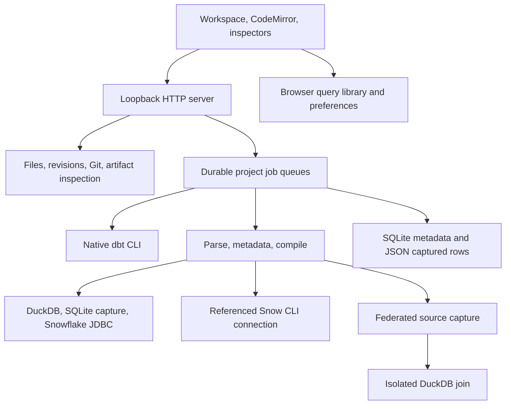

# Architecture

Clojure owns the API, workspace, job queues, and query processor.
ClojureScript/Fulcro, React panels, and CodeMirror own the browser interface.
Native dbt 2.0.5 handles project parsing, Jinja compilation, materialization, and tests.

## Query execution

The pipeline separates parsing, query-scoped metadata, compilation, and execution.
Metadata resolves project profiles, registered connections, model routes, manifests, and baseline identities.
There is no global mutable query metadata cache.

JSqlParser identifies physical tables, parameters, and unsafe operations.
Malli validates requests and structured EDN. HoneySQL compiles query maps to SQL with separate parameter values.
The SQL-to-EDN API supports a bounded grammar and reports unsupported expressions.
Browser mode switches change highlighting and execution mode while preserving document text. Visual mode is disabled.
Tokenization preserves strings and comments when splitting statements or binding parameters.

DuckDB opens database files read-only. SQLite previews copy referenced DuckDB relations into memory.
Snowflake JDBC resolves environment-backed credentials and executes validated SELECT queries.
Snow CLI uses a configured connection reference and bounded JSON output. It infers result types from returned values.

Federation resolves `connection.schema.table` or model routes, then copies supported scalar values into isolated DuckDB.
Source JDBC metadata supplies declared types. Each source capture has a row cap; exceeding it fails the query.
Captures share a deadline but no cross-source transaction. The final join uses DuckDB semantics.
Snow CLI inputs are refused because their JSON results lack declared source types.

## State and inspection

The runtime serializes jobs within each project. Independent projects can run concurrently.
Native dbt uses per-job artifact directories. Demo builds can prepare baseline relations before development relations.
Deferral uses dbt state and favor-state flags.

SQLite persists jobs, events, summaries, and result metadata. JSON files preserve captured rows.
Activity records full drafts, execution scope, parameters, bindings, artifact identities, limits, and per-statement result IDs.
Batch execution stops on the first failure and retains completed results.
Row comparison uses unordered rows and preserves duplicate counts.

Inspection reads manifests, catalogs, run results, and source freshness artifacts.
The catalog inventories manifest resource types, including macros. Lineage keeps its dependency graph separate from macro inventory.
Run inspection reads artifact files even when failed jobs lack summary artifacts.
Run comparison summarizes recorded model/test outcomes and timing; it does not compare database rows.
Overview combines recorded tests, local Git changes, recent jobs, and transitive model dependencies.

File saves require the latest content revision and preserve before/after versions.
Loading a historical version creates a draft. Active jobs block file saves and reference changes.
Generated paths, profiles, symbolic links, and paths outside the project are excluded from editing.
Baseline artifacts preserve compilation state, not source rows.

## Local and remote operations

Connection registration stores local settings or references. It does not rewrite dbt profiles.
Saved Snowflake credentials name environment variables. Snow CLI import saves only a configured connection name.
Model routing validates destination relations and records explicit overrides.

Git stages and commits project files, switches branches, rebases, and cherry-picks locally.
Conflicts remain available for terminal resolution or abort.
GitHub uses the authenticated `gh` CLI. Pull-request and check reads require explicit UI actions.
Draft creation requires a published matching branch. The workbench does not push commits.

## Browser and distribution

The left navigation collapses to icons and retains labeled project-tool actions.
Overview, Documentation, Connections, Environment routing, Version control, and Metadata open between navigation and Query lab.
Query lab stays mounted independently of project views and lower tabs.
Results, Lineage, Activity, Changes, and Runs & tests share the resizable panel below its editor.
Query lab contains the file tabs and CodeMirror editors alongside a scratch query.
The right Files pane contains the sole file explorer.
Models and All files filter one tree, replacing the duplicate left file list.
Multiple file tabs retain drafts, selection, undo history, and editor mode. Loading saved queries activates the scratch document.
Pane sizes, explorer visibility, file views, and navigation collapse persist in browser storage.
Metadata follows the active file. Its static lexer infers literal Jinja calls and unambiguous outer SELECT field names.
It reads JSON top-level types without evaluating templates. Recorded schema and dependencies come from existing dbt artifacts.
Types, dynamic expressions, wildcards, and ambiguous projections remain explicitly unknown during draft inference.
A global status bar shows progress, elapsed time, errors, and cancellation across views.
The browser query library saves drafts per project and exports JSON.
Formatting preferences and query drafts remain in browser storage, separate from server persistence.
Charts aggregate sampled saved rows into multiple metrics and optional breakdown categories.
Sum, Average, Count rows, and Count distinct feed bar or line plots with legend controls.
Rendering is bounded to 1,000 saved rows, 40 groups, and eight series.

Bun installs pinned dependencies. shadow-cljs compiles assets into `resources/static/js`.
SQL Formatter's browser bundle is copied unchanged to preserve its regular-expression templates.
CodeMirror uses Nextjournal's Clojure grammar for EDN.
The native dbt installer verifies its pinned archive checksum.
