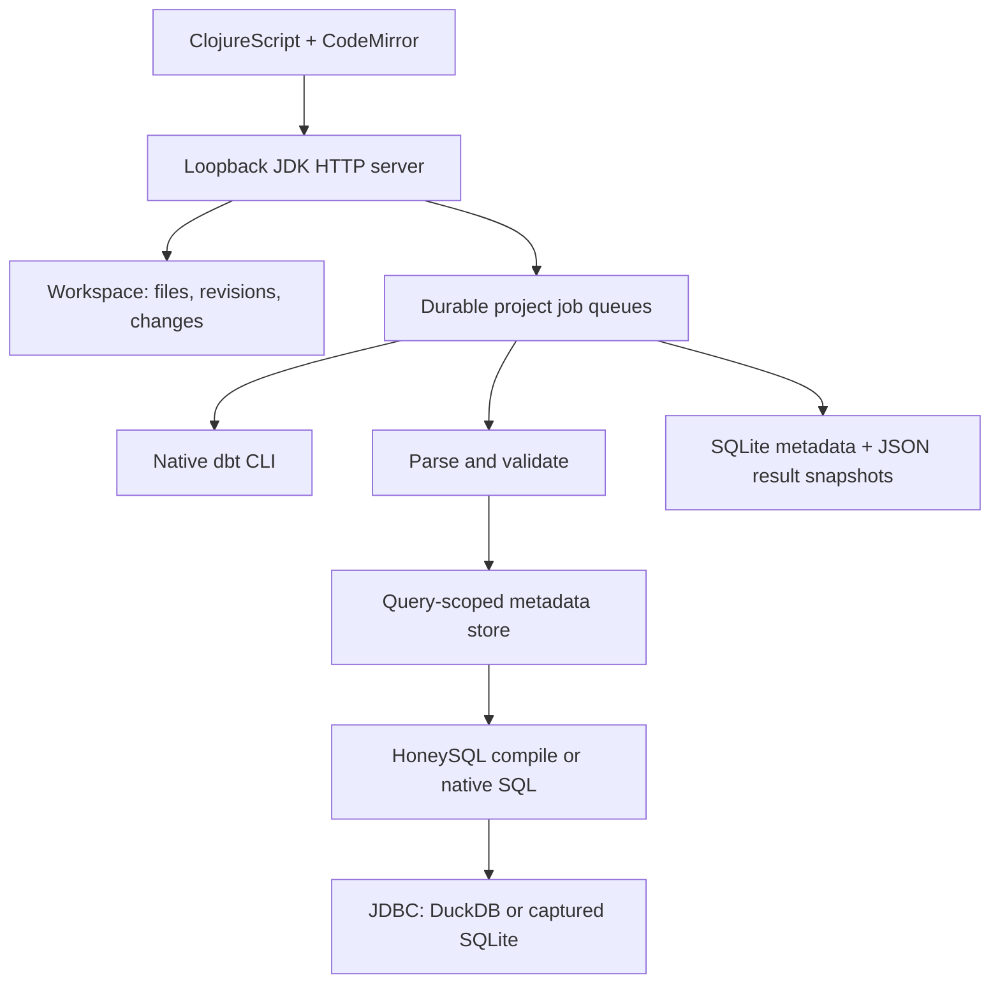

# Architecture

Clojure owns the API, workspace, job runtime, and query processor.
ClojureScript/Fulcro and CodeMirror own the browser interface.
Native dbt 2.0.5 owns project parsing, Jinja compilation, materialization, and tests.
Python and SQLGlot were removed from the application.

## Query processor

The pipeline separates parsing, query-scoped metadata, compilation, and driver execution.
It follows Metabase's stage boundaries without copying its implementation or adding a Metabase runtime.
Metadata comes from explicit project profiles, manifests, and baseline artifact identities.
There is no mutable global query metadata cache.

JSqlParser validates native SQL and identifies physical tables, parameters, and unsafe operations.
Malli validates external requests and structured EDN. HoneySQL lowers structured expressions to bound SQL.
SQL-to-EDN maps parsed projections, expressions, sources, joins, CTEs, grouping, and ordering into HoneySQL data.
Unsupported conversion nodes fail with a diagnostic while the browser retains the draft.
EDN-to-SQL compiles through HoneySQL, emits named parameters, and returns values separately.
A vector of maps expresses sequential queries. Legacy versioned EDN remains readable for saved job replay.
Visual controls edit the same HoneySQL map. A read-only information-schema catalog supplies table and column choices.
SQL tokenization preserves strings and comments while binding named parameters and normalizing parser input.

DuckDB connections are read-only. SQLite runs bounded copies of referenced DuckDB tables in memory.
Native division is refused in SQLite because its numeric semantics can differ.
Structured division defines floating-point, NULL-on-zero behavior for both engines.
Read-only function validation, row limits, deadlines, and cancellation bound query execution.

## Jobs, persistence, and edits

The runtime serializes jobs within each project and allows independent projects to run concurrently.
Native dbt uses per-job artifact directories. Successful Build includes dbt tests.
The demo's first Build also prepares baseline relations. Advanced choices remain under Build options.
Deferral uses dbt's own state and favor-state flags.

SQLite persists job inputs, events, summaries, and result metadata.
JSON files preserve captured rows. Comparisons use unordered row multisets and retain duplicate counts.
Activity records full editor text, execution scope, parameters, targets, artifact hashes, bindings,
timestamps, limits, errors, and individual statement results.
Batch execution stops at the first failure and retains completed results.

File saves require the latest SHA-256 revision. Saves record immutable before/after versions.
Loading a version makes an editable draft; Save creates another recorded change.
Saves and baseline imports wait until that project's queued and active jobs finish.
Symbolic links, generated directories, profiles, and paths outside the project are excluded.

Baseline artifact directories preserve successful compilation state, not source database contents.
External editors and database writers remain outside the workbench's transaction boundaries.
Existing Python-era job metadata is retained. Legacy Arrow rows need a saved-query rerun.

## Frontend and distribution

Bun installs pinned dependencies and shadow-cljs compiles the UI into `resources/static/js`.
The compiled assets ship in the repository. Java and Clojure run the application.
SQL Formatter uses its published browser bundle. Closure optimization alters its raw named-capture templates, so the build copies it unchanged.
CodeMirror uses Nextjournal's Clojure grammar for EDN highlighting. Formatting preferences persist in browser storage.
The native dbt installer verifies a pinned release archive with SHA-256.
`DBT_WORKBENCH_DBT` can select another executable with the project's required platform support.
