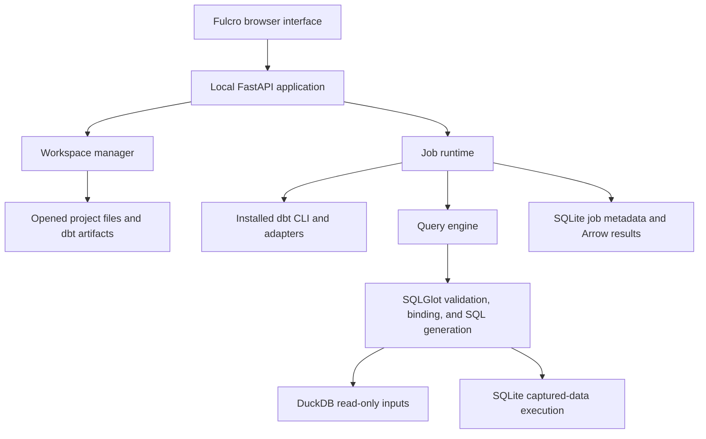

# Architecture

The workbench keeps dbt authoritative for project parsing, Jinja rendering, adapter behavior, and native builds. It adds a local editing interface, durable jobs and results, explicit baseline references, and bounded query previews.



## Workspace and native execution

Opening a project records its path and profiles directory. It does not copy the project. SQL, YAML, and EDN files can be read and saved within that project; a SHA-256 revision check prevents an older editor buffer from overwriting a concurrent change. Generated directories, dependency directories, profile files, and symbolic links are excluded from editing. Saves and baseline imports are blocked while that project has queued or active jobs. An external editor can still change project files; the workbench does not freeze an entire project revision before running dbt.

The bundled Jaffle Shop demo is different: the workbench makes an application-owned copy and writes a local profile with separate `baseline` and `dev` DuckDB databases. The development profile attaches the baseline database read-only.

Native jobs invoke the configured dbt executable without a shell and use separate artifact and log directories per job. Parsing, building, testing, and compiling use the project's own adapter and dbt configuration. The runtime checks both the process exit code and the statuses in `run_results.json` before accepting a build or baseline as successful. Work is serialized per project. A process-level lock prevents two workbench instances from using the same data directory at once.

`DBT_WORKBENCH_DBT` selects a dbt executable explicitly. Otherwise the runtime looks for dbt in its Python environment or executable path. The bundled adapter is dbt-duckdb. Additional native adapters and project packages belong in the selected dbt environment.

## Baselines and relation resolution

A baseline action runs `dbt build` against the requested target and publishes its successful artifacts into a new immutable baseline directory. Existing artifacts can also be copied in through `POST /api/projects/{id}/baseline/import`, using a local artifact directory and its target name. The importer validates the manifest structure; the caller supplies artifacts from a trusted, successful build. The registry keeps baseline history. This version executes deferral against the latest baseline; selecting an older baseline is not implemented.

The baseline represents **dbt state**, not a point-in-time copy of table data. Its manifest and other artifacts do not change after publication. Its referenced database relations can change when that target is built again or updated elsewhere.

Native builds use dbt's own `--defer`, `--state`, and optional `--favor-state` behavior. Deferral only helps where the active adapter can access the referenced relations. It does not copy data between databases or grant access. An existing development relation normally takes precedence unless `--favor-state` applies; selected nodes are still built in the selected target.

Query previews maintain their own explicit mapping from dbt model identities to accessible physical relations. This makes the selected inputs visible in result provenance. The workbench resolves physical table references with SQL scope awareness so a common-table-expression name is not mistaken for a database table.

There are three distinct kinds of saved state:

| State | What is preserved | What can still change |
| --- | --- | --- |
| Baseline artifacts | A successful manifest and build artifacts | Referenced database table contents |
| Opened project | Its registered path and edited files | Files can be edited outside the workbench |
| Saved query result | Captured Arrow rows and result metadata | Its source databases can change independently |

A saved result can be inspected or compared later without re-querying its sources. Download serves CSV; Arrow is the internal result format.

## Query execution

A preview of current project code first asks dbt to compile the selected model in its adapter context. A baseline preview reads the saved compiled SQL directly, so editing the current project does not rewrite the baseline query. SQLGlot receives compiled SQL, never raw Jinja. The engine validates the query, binds its physical inputs, and executes supported read-only SQL against local DuckDB inputs. SQLite previews use an actual in-memory SQLite database populated with captured inputs.

SQLGlot supplies parsing, SQL transformation, and generation. Successful generation alone is not considered evidence of equivalent execution. The engine rejects unsupported constructs, uses bounded input capture, and records original SQL, executed SQL, relation bindings, and warnings in provenance.

The first release implements these preview execution paths:

- Local DuckDB profile → DuckDB query execution.
- Local DuckDB profile → captured tables → SQLite query execution.

Native dbt adapter support is broader than this preview support. A project can use its installed native adapter for dbt jobs without that warehouse becoming a supported interactive preview input.

## EDN query document

The query lab accepts an EDN v1 document as well as SQL. EDN is the authoritative representation for that submitted structured query; it is not a replacement for the project's existing dbt SQL files.

```clojure
{:query/version 1
 :from {:model "model.jaffle_shop.orders" :as "o"}
 :select [{:as "customer_id" :expr [:field "o" "customer_id"]}
          {:as "revenue" :expr [:sum [:field "o" "amount"]]}]
 :where [:eq [:field "o" "status"] [:param "status" :text]]
 :group-by [[:field "o" "customer_id"]]
 :order-by [{:expr [:field "o" "customer_id"] :direction :asc}]
 :limit 100}
```

Parameters are submitted separately, for example `{"status":"completed"}`. Declared parameter types are `:text`, `:integer`, `:float`, `:boolean`, and `:date` (an ISO date string). Missing or extra parameters and conflicting declarations are rejected. A `:binding` of `:baseline` or `:dev` can be supplied in `:from` to choose that relation source explicitly.

Supported expression families include field references and typed parameters; addition, subtraction, multiplication, and division; comparisons; boolean expressions; null checks and coalescing; and sum, count, minimum, maximum, and average aggregates. Projection, filtering, grouping, ordering, and row limits form the relational layer. This is a closed operator vocabulary: arbitrary EDN function calls are not evaluated.

Structured division explicitly means floating-point division with `NULL` when the denominator is zero. Existing raw SQL retains its native meaning on the native engine; risky cross-engine forms such as raw division, casts, date operations, and unknown functions can be rejected. The engine does not silently assign the structured operator's meaning to arbitrary source SQL.

The document format is intentionally independent of the compiler's internal AST. Fulcro edits and submits these documents; SQLGlot performs supported lowering. Metabase, Pathom, Ibis, and SQLMesh are not runtime dependencies of this version.

## Jobs, cancellation, and comparison

Jobs have persistent statuses and ordered log events. The browser polls events using a sequence cursor and loads result pages rather than keeping every result row in application state.

Cancellation requests propagate to the query worker or dbt process group. A running process receives termination, with escalation if necessary. A job becomes cancelled after its worker exits. On application restart, previously active jobs are marked interrupted rather than replayed automatically. Cancelling a dbt job cannot undo database work already committed.

Comparisons use captured results. Without key columns, comparison treats rows as an unordered multiset, preserving duplicate counts. With key columns, each side must have unique keys, and rows are compared by key. Numeric comparison is exact; it does not apply a statistical or floating-point tolerance. The comparison summary reports `equal` for row values and separately reports `schema_equal` for Arrow field names and types. Results marked truncated cannot be compared; rerun narrower queries or raise the row bound first.

## Development boundary

The shipped interface is compiled ClojureScript using Fulcro. FastAPI serves both the static assets and the JSON API. Rebuilding the interface requires Node.js and a JDK; running a built package requires Python and its installed dependencies.

The server is restricted to loopback hosts. It is a single-user local application with access to the project paths and credentials of the process running it. A dbt project can execute macros, hooks, and native database operations; opening and building projects assumes they are trusted by that user.
