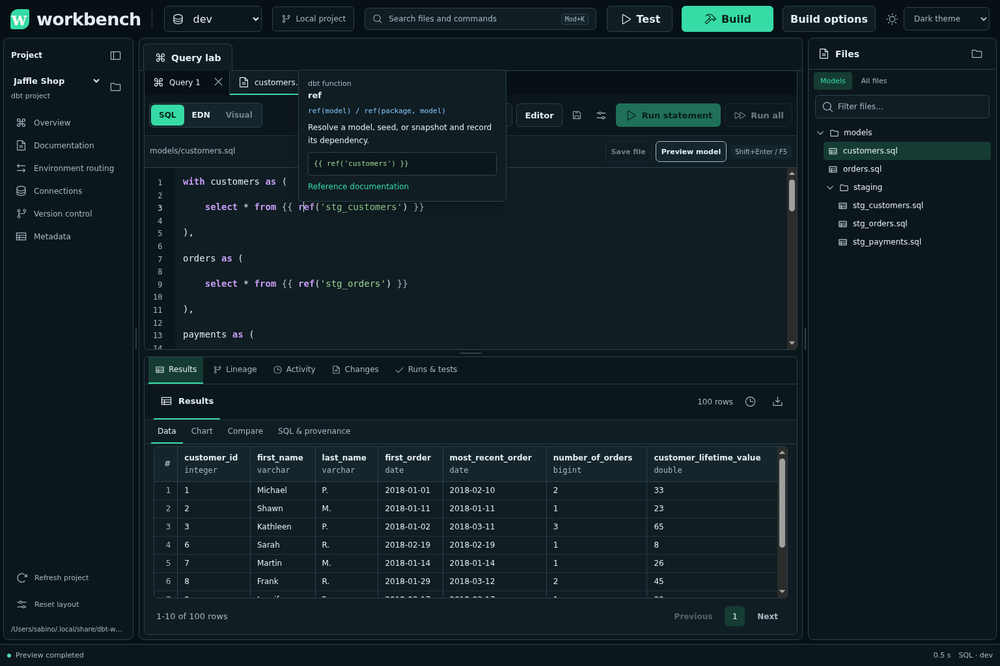
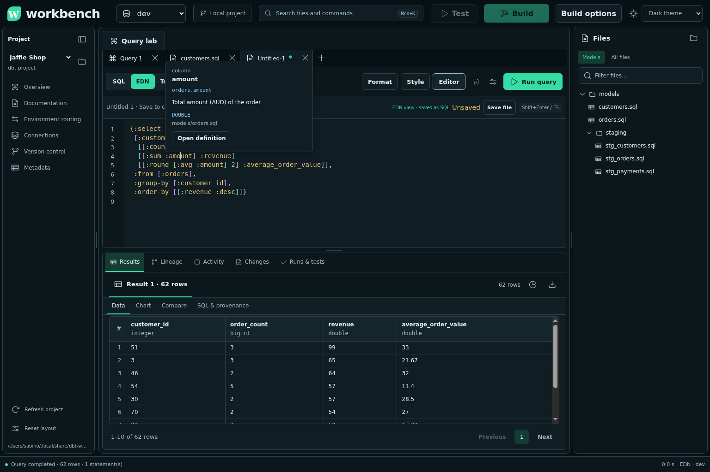
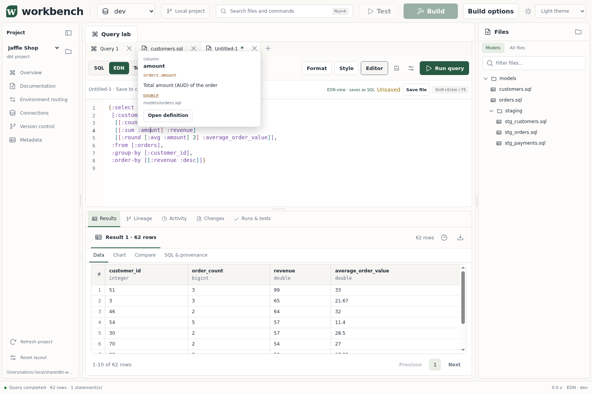

# Project-aware SQL and EDN editing

Complete project relations, inspect field documentation, and open definitions without leaving the editor.
EDN supports structural navigation and editing. **Editor** settings choose Paredit, Parinfer, or plain editing.

## Complete and inspect references

Press **Ctrl+Space** to request completion. Hover a reference, or press **Ctrl+Shift+Space**, to read its documentation.
Suggestions use local project declarations and recorded manifest/catalog artifacts.
The editor metadata endpoint reads local files; it does not query a warehouse or execute macros.

| Context | Suggestions and help |
| --- | --- |
| SQL | Relations, fields, alias-qualified fields, and supported SQL functions |
| SQL Jinja | dbt functions and context variables, project/package macros, `ref` model names, and `source` names and tables |
| HoneySQL EDN | Clause keywords, expression functions, relation keywords, and fields |

For example, fields from `customers` can appear after alias `c`:

```sql
select c.customer_id
from {{ ref('customers') }} as c
```

In EDN, write HoneySQL relations and expressions:

```clojure
{:select [:c.customer_id [[:sum :o.amount] :total]]
 :from [[:customers :c]]
 :join [[:orders :o] [:= :c.customer_id :o.customer_id]]
 :group-by [:c.customer_id]}
```

SQL template help includes `config`, `var`, `env_var`, adapter methods, conversion helpers, and context variables such as `this`, `target`, and `graph`.
It describes these names without evaluating their runtime values.
EDN help describes HoneySQL data. dbt Jinja macro completion belongs inside SQL template blocks.
Field help displays types only when available in declarations or recorded metadata.

**Ctrl/Cmd-click** or **F12** opens the project file for a resolved model, source, or macro.
Source references open their declaration file. Package resources without an editable local file provide help instead.
Dynamic references and ambiguous names have no chosen definition.
Use package-qualified `ref` calls or relation aliases to make supported references unambiguous.
CTE names shadow project relations. The editor does not infer CTE or subquery output columns.
Unresolved relations suppress unqualified field hints, rather than borrowing columns from a similarly named model.

If project metadata is missing, **Editor** settings and documentation help explain the available context.
Local model, seed, source, and macro declarations provide fallback suggestions before a manifest exists.
Refresh project metadata after changing declarations. Parse or build to refresh recorded dbt artifacts.
Descriptions, types, and resources can be incomplete or stale. See [editor limits](limitations.md#editor-assistance).

## Edit EDN structure

| Editor setting | Behavior |
| --- | --- |
| Paredit, the default | Edits balanced forms and supports structural commands |
| Parinfer | Uses smart mode to reconcile indentation and parentheses during typing, deletion, and indentation edits |
| Plain | Uses standard text editing without automatic structural correction |
| Rainbow EDN delimiters | Colors nesting depth; off by default |

Changing these settings preserves the buffer. Preferences stay in this browser.
Parinfer does not rewrite conversion, undo/redo, completion, paste, or selection-only transactions.
It also skips selected deletion and multiple-cursor edits.
**Format** remains explicit. **Always format on mode switch** is a separate option, off by default.
Returning from untouched EDN restores the original SQL, including comments and spacing.
Edited EDN compiles before saving a native `.sql` file. Conversion failures preserve the draft.
Compile dbt Jinja through **Preview model** before attempting SQL/EDN conversion.

## Commands and shortcuts

Open **Keyboard shortcuts** in the command center to assign bindings or restore defaults.
`Mod` means Command on macOS or Ctrl elsewhere. `Ctrl` and `Alt` below denote those literal keys.

| Command | Default shortcut |
| --- | --- |
| Find files / commands / both | Mod+P / Mod+Shift+P / Mod+K |
| Complete / show documentation / open definition | Ctrl+Space / Ctrl+Shift+Space / F12 |
| Format document | Alt+Shift+F |
| Move forward / backward one EDN form | Alt+ArrowRight / Alt+ArrowLeft |
| Move out of / into a form | Alt+ArrowUp / Alt+ArrowDown |
| Expand / contract selection | Alt+Shift+ArrowUp / Alt+Shift+ArrowDown |
| Slurp next form / barf last form | Ctrl+Alt+ArrowRight / Ctrl+Alt+ArrowLeft |
| Slurp previous form / barf first form | Ctrl+Alt+Shift+ArrowRight / Ctrl+Alt+Shift+ArrowLeft |
| Wrap in vector, map, or list; splice enclosing form | Assign in Keyboard shortcuts |

Slurp moves a neighboring form inside the collection. Barf moves an edge form outside it.
Splice removes the enclosing delimiters. These editing commands change the draft.
Navigation commands move or select forms. Structural commands operate in EDN mode.
Each explicit structural editing action has its own undo step.
Parinfer's correction and the triggering edit share one undo step.

## Editor captures







## Upstream references

Workbench bindings come from its command registry, so they can differ from package defaults.
Consult [Nextjournal's Clojure mode](https://github.com/nextjournal/clojure-mode) for the structural editor foundation.
[Parinfer](https://github.com/parinfer/parinfer.js) describes indentation-based parenthesis inference.
Use the [dbt Jinja reference](https://docs.getdbt.com/reference/dbt-jinja-functions/ref) for model references.
[HoneySQL's clause reference](https://github.com/seancorfield/honeysql/blob/develop/doc/clause-reference.md) documents EDN query forms.
