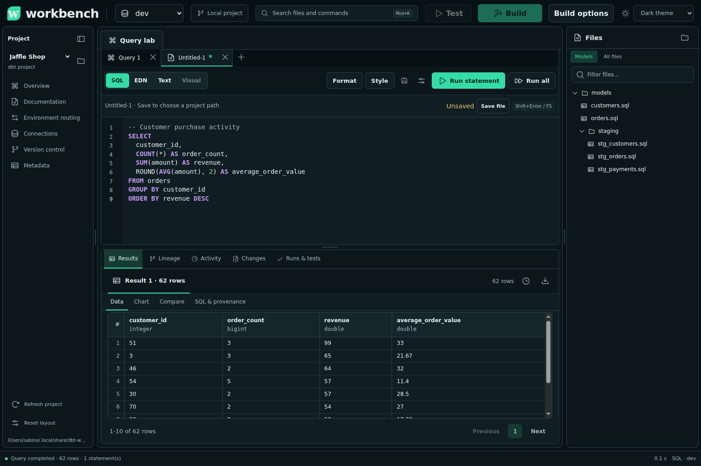
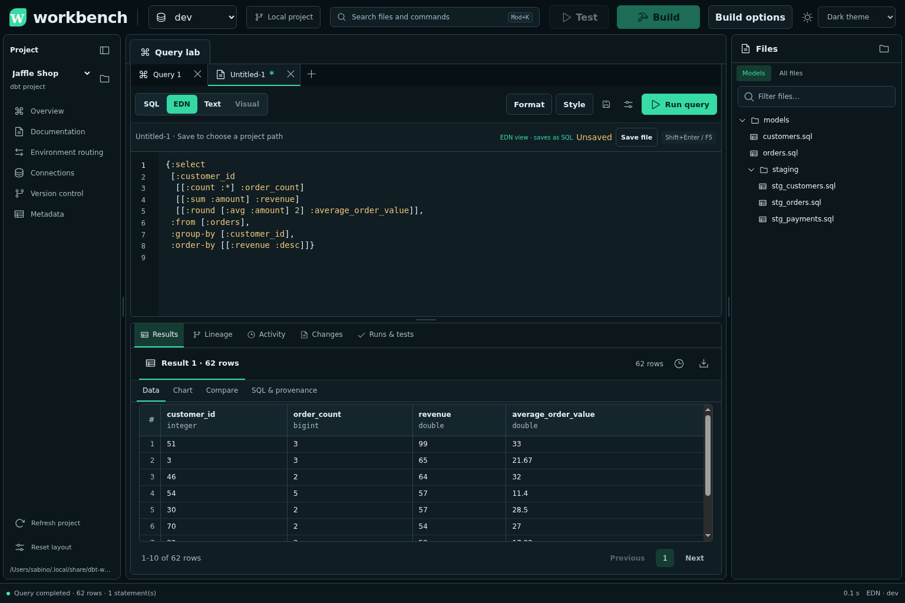
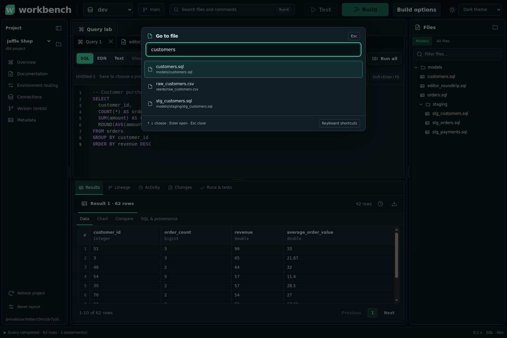
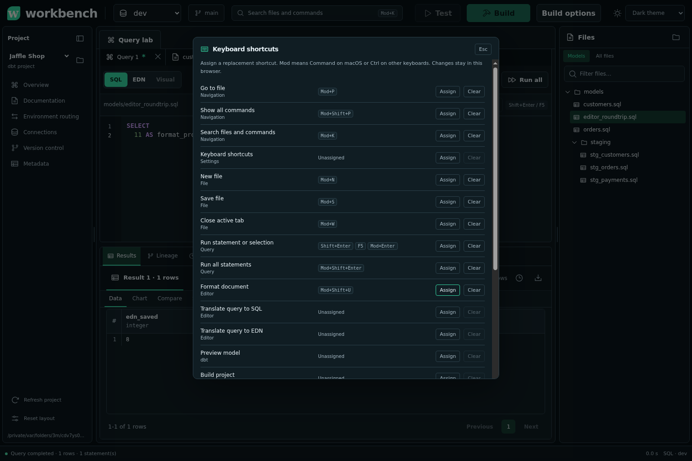
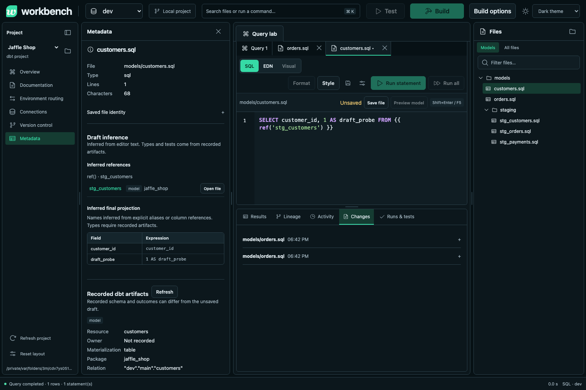
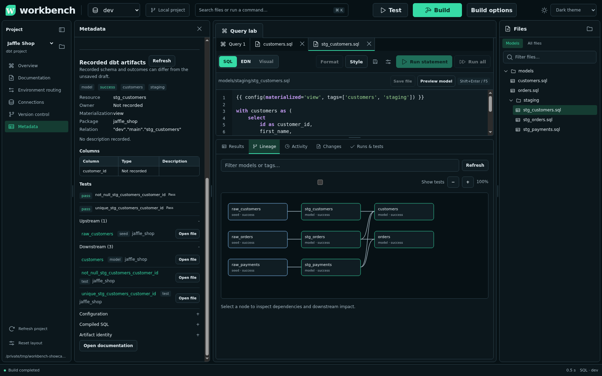
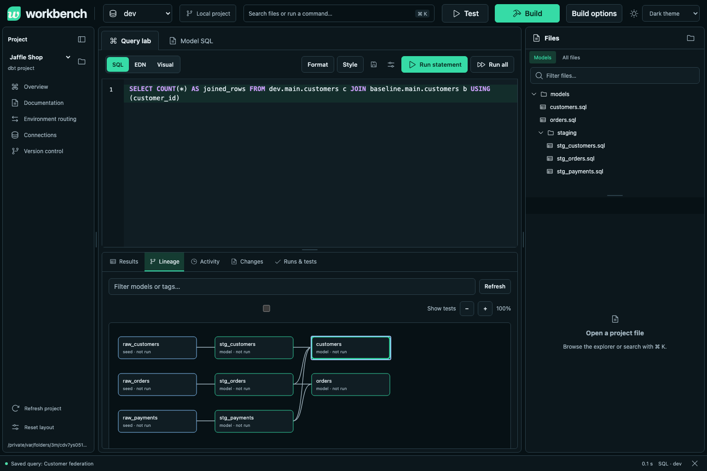
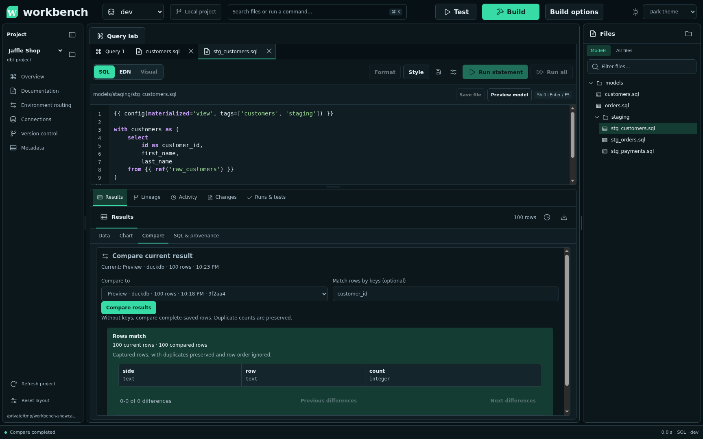

# Screenshots and workflows

These captures use the bundled Jaffle Shop demo in an isolated Linux Chromium browser.
The server runs locally. The displayed rows and dbt outcomes come from executed demo jobs.

## Edit files and inspect results

Open files from the right-hand explorer. Each file opens in a Query lab tab beside the scratch query.
Use the final **+** tabstrip control to open an untitled document. A **\*** marks unsaved changes.
**Save file** opens a path dialog for untitled files. Confirm an unused project path to create the file.
Use **Preview model** to compile and query a saved dbt model.
Results appear below the editor. The status bar stays at the viewport bottom.

Drag dividers to resize panes. Collapse navigation or hide Files when you need more space.
Layout and theme choices survive reload in the same browser.

## Translate and format queries

Choose **EDN** to translate supported SQL into HoneySQL data.
Return to **SQL** without editing EDN to restore the exact source, including comments and spacing.
Edited EDN compiles to SQL before saving a `.sql` file.
Unsupported conversion and dbt Jinja leave the draft intact. Compile templates with **Preview model** first.
**Format** works on either representation. **Style > Always format on mode switch** is off by default.
Enabling it also formats restored SQL.

## Find files and commands

Open the header's command center, or press Mod+P for files, Mod+Shift+P for commands, or Mod+K for both.
Mod means Command on macOS or Ctrl on other keyboards.
Choose entries with arrow keys and Enter. Escape closes the dialog.
Open **Keyboard shortcuts** to assign keys or restore defaults. Settings remain in the same browser.

## Inspect model metadata

Choose **Metadata** below Version control. Its pane follows the active file while Query lab stays visible.
Draft parsing exposes static references, configuration, and projected field names.

Recorded dbt artifacts supply test outcomes and upstream and downstream resources.
Expand these sections to inspect dependencies or open related files.
Types remain unknown when the available artifacts do not record them.

## Explore lineage

Choose **Lineage** below Query lab. Enlarge the lower pane to inspect the graph.
Select a node to inspect dependencies and downstream impact.
The demo graph connects three seeds to staging models and customer and order marts.

## Compare saved results

Open **Results > Compare**. The current result is already selected.
Choose another saved result, then **Compare results**. Optional keys match rows by selected columns.
Without keys, comparison preserves duplicate counts and ignores row order.

This capture compares two complete 100-row previews.
Truncated captures cannot prove complete source equality. See [execution limits](limitations.md).

See the [verification record](verification.md) for automated checks and external-service coverage.
