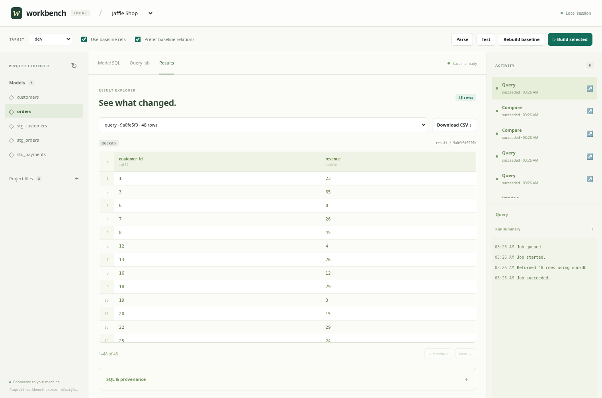

# Verification

Validated on Linux with Python 3.12, Java 21 for the frontend build, and headless
Chromium. Runtime engine versions are pinned in `pyproject.toml` and `uv.lock`.

Completed on 2026-10-09: **99 tests and 12 subtests passed**. The full browser
workflow completed **11 jobs**: ten succeeded and the deliberate long query was
cancelled. It recorded **zero uncaught browser errors**. Five additional fast-query
checks confirmed that completed results open once and later navigation is kept.

## Automated checks

```sh
uv sync --extra test
uv run pytest -q
uv run playwright install chromium
uv run python tests/browser_smoke.py --output /tmp/workbench-browser
uv build
```

The Python suite has **99 tests**, including three full integration workflows,
plus **12 parameterized subtests**. It uses real dbt, DuckDB, and SQLite.
The browser script starts a separate temporary server and drives the actual
Fulcro interface; its output directory contains screenshots, a downloaded CSV,
and a JSON record of the submitted jobs.



The tested Jaffle Shop workflow builds three seeds and five models, passes all
20 dbt tests, and saves a reference manifest. It changes `orders` to include only
completed orders, builds that selected model in development with upstream
deferral, and compares **99 baseline rows against 67 development rows**.
A parameterized EDN aggregation returns **48 matching rows** from DuckDB and
SQLite. Column types differ, and that difference is reported separately.

The browser workflow also exercises saved baseline SQL, result comparison,
native SQL, CSV download, cancellation, a successful query after cancellation,
and history after reloading the page. It must finish without uncaught browser
errors. The frontend release compiler completes without warnings.

## Regression coverage

- dbt artifact statuses are checked even if the process exits successfully.
- Revision conflicts, symlinks, path traversal, active-job edit protection, and
  foreign browser origins are covered.
- CTE scope, identifier case, correlated columns, default schemas, and physical
  relation bindings are checked against native DuckDB behavior.
- Unsafe query forms, implicit external file scans, unsupported SQLite decimal
  inputs, row limits, deadlines, and cancellation have explicit cases.
- Truncated results cannot report complete equality. Row equality and schema
  equality are distinct.
- Saved events/results survive restart, duplicate application instances are
  rejected, and stale baseline IDs cannot silently use current state.

## Distribution check

The wheel was installed into a clean Python environment and used to start the
server, serve its HTML and compiled JavaScript, and create the packaged Jaffle
Shop demo. It includes the frontend, demo seeds/models, and third-party notices.
Node and Java are not needed to run an installed distribution.

These checks validate the implemented DuckDB/SQLite workflow. They do not
certify arbitrary SQLGlot dialect pairs, warehouse adapters, or semantic
equivalence for all SQL. See [limits](limitations.md) and [roadmap](roadmap.md).
